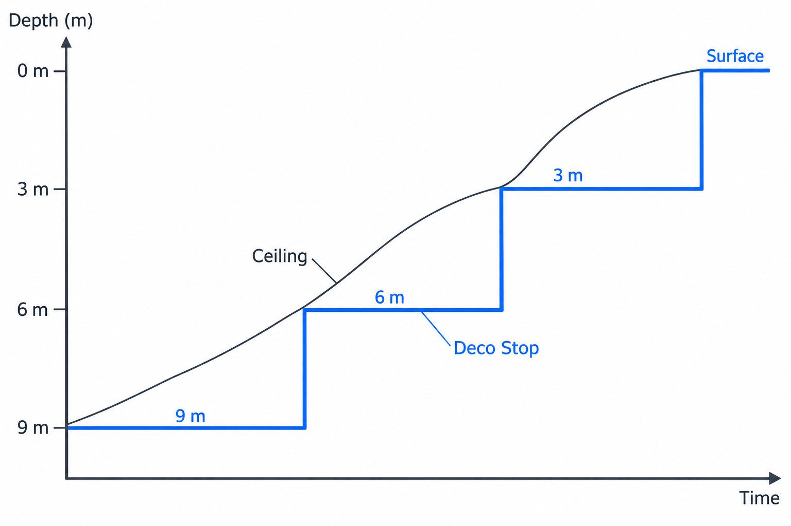
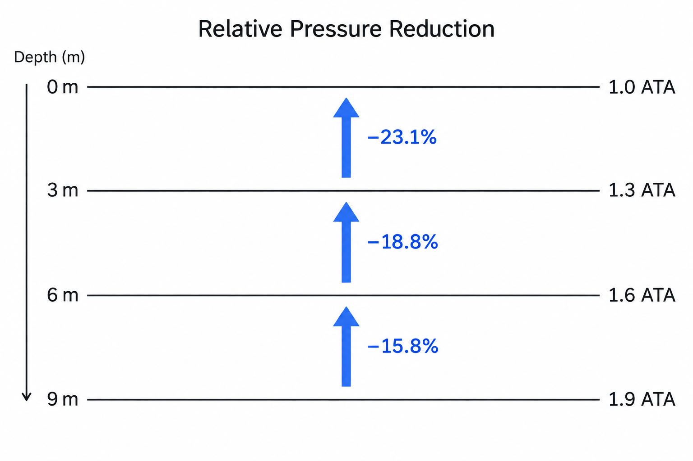

테크니컬 다이빙을 마치고 상승을 시작하면 다이빙 컴퓨터에는 독특한 숫자들이 나타납니다. 수심 12미터에서 정지하고, 다음은 9미터, 그다음은 6미터, 마지막은 3미터입니다. 마치 보이지 않는 수중 계단을 한 칸씩 올라가듯 감압 정지(Decompression Stop) 수심은 일정한 3미터 간격으로 배치됩니다.

그런데 여기서 한 가지 의문이 생깁니다. 왜 하필 3미터일까요? 2미터씩 올라가면 위험하고, 4미터씩 올라가면 감압병에 걸리는 것일까요? 아니면 인간의 신체 조직이 정확히 3미터의 수압 변화를 견디도록 설계되어 있는 것일까요?

흥미롭게도 **3미터는 인체의 생리학적 한계에서 도출된 절대적인 숫자가 아닙니다.** 그 기원은 100년도 더 된 감압 연구의 역사에 있으며, 이 단순한 간격 뒤에는 체내 불활성 기체의 압력과 주변 수압 사이의 복잡한 수학적 관계가 숨어 있습니다.

### 3미터의 기원: 인간의 몸이 아니라 감압표가 만든 숫자

오늘날 우리가 사용하는 단계 감압(Staged Decompression)의 역사는 1908년 영국의 생리학자 존 스콧 홀데인(John Scott Haldane)과 그의 동료들이 발표한 감압 연구로 거슬러 올라갑니다.

당시 다이버들은 수중 작업을 마치고 수면으로 돌아오는 과정에서 감압병(Decompression Sickness)에 노출되었습니다. 홀데인 연구진은 다이버가 일정한 깊이에서 멈추어 체내에 축적된 질소를 배출한 다음, 더 얕은 수심으로 이동하는 단계적인 상승 방식을 체계화했습니다.

초기 감압표에서 사용되던 대표적인 정지 간격이 바로 **10피트(10 ft)** 였습니다.

당시 영국 해군은 피트 단위를 사용했고, 수면에서 펌프와 압력계를 관리하는 작업자는 다이버에게 일정한 수심마다 정지하거나 상승하도록 신호를 보낼 수 있었습니다. 일정한 간격으로 반복해서 정지하는 방식은 감압 절차를 관리하고 실험 결과를 비교하기에도 편리했습니다.

10피트를 미터법으로 환산하면 약 3.05미터입니다. 우리가 사용하는 3미터 간격은 이러한 초기 감압표의 관행이 이후 감압 절차와 다이빙 컴퓨터에 계승된 결과입니다.

다시 말해, 인간의 조직이 3미터마다 특별한 생리학적 변화를 일으키기 때문에 이 간격이 선택된 것은 아닙니다. **감압을 반복 가능하고 통제 가능한 절차로 만들기 위해 선택된 실용적인 단위**가 오랜 세월 표준으로 자리 잡은 것입니다.

### 감압 천장: 다음 계단으로 올라갈 수 있는 조건

그렇다면 3미터라는 간격 자체가 생리학적 기준이 아니라면, 컴퓨터는 무엇을 계산해 다음 감압 정지 수심으로 이동하라는 지시를 내릴까요?

핵심은 감압 천장(Decompression Ceiling)이라는 개념입니다.

다이버가 깊은 수심에서 호흡하는 동안, 높은 불활성 기체 분압에 노출된 신체 조직에는 질소나 헬륨이 용해됩니다. 상승을 시작하면 주변 수압과 호흡 기체의 불활성 기체 분압이 낮아지면서 조직에 축적된 기체가 혈액과 폐를 통해 배출되기 시작합니다.

문제는 조직에 녹아 있는 기체의 압력이 주변 수압보다 얼마나 높아질 수 있는가에 있습니다.

이러한 압력 차이로 형성되는 상태를 과포화(Supersaturation)라고 합니다. 적절한 과포화는 불활성 기체가 조직에서 빠져나오는 구동력이지만, 과도한 과포화는 기포의 형성 및 성장과 관련된 감압병 위험을 높일 수 있습니다.

대표적인 용존 기체 감압 모델인 뷜만(Bühlmann) 모델은 서로 다른 기체 교환 속도를 가진 조직 구획(Tissue Compartment)을 계산하고, 각 조직 구획이 주어진 주변 압력에서 허용할 수 있는 불활성 기체 압력의 상한을 설정합니다. 이 상한을 M-value라고 부릅니다. 실제 감압 계획에서는 경사도 계수(Gradient Factor)를 이용해 이러한 허용 한계에 여유를 두기도 합니다.

이처럼 가상의 조직 구획과 M-value를 이용해 감압 한계를 계산하는 과정은 [다이빙 컴퓨터에 숨겨진 수학적 원리](https://taehoonkwon.com/scuba/the-hidden-math-behind-your-dive-computer)에서 자세히 다룬 바 있습니다.

이 계산을 통해 도출되는, 현재 조직 상태에서 허용되는 가장 얕은 수심이 바로 감압 천장입니다.

예를 들어 다이빙 컴퓨터가 계산한 감압 천장이 수심 8미터라고 가정해 봅시다. 다이버는 이보다 얕은 7미터나 6미터로 올라가서는 안 되지만, 더 깊은 9미터에서는 정지할 수 있습니다.

9미터에서 호흡하며 시간이 지나면 조직의 불활성 기체 압력이 낮아지고, 감압 천장은 점차 수면 방향으로 이동합니다. 마침내 천장이 6미터 또는 그보다 얕아지면 다음 6미터 정지 지점으로 상승할 수 있게 됩니다.

중요한 사실은 조직 속 기체 압력도, 감압 천장도 실제로는 연속적으로 변한다는 점입니다. **우리 몸은 3미터 단위로 감압하는 것이 아니라, 컴퓨터가 연속적으로 계산한 감압 한계를 다이버가 따르기 쉬운 3미터 간격으로 표현하는 것입니다.**

### 수면에 가까워질수록 커지는 3미터의 의미

그렇다고 3미터라는 간격이 물리적으로 아무런 의미가 없는 것은 아닙니다.

수중에서는 약 10미터 깊어질 때마다 주변 압력이 1기압씩 증가합니다. 반대로 상승할 때는 그만큼 압력이 감소합니다. 따라서 3미터를 상승할 때마다 주변 압력은 약 0.3기압씩 낮아집니다.

하지만 같은 0.3기압의 감소라도 출발 수심에 따라 상대적인 변화의 크기는 달라집니다.

수심 9미터에서 6미터로 상승할 때 주변 압력은 1.9기압에서 1.6기압으로 낮아집니다. 약 15.8%의 감소입니다. 수심 6미터에서 3미터로 상승하면 1.6기압에서 1.3기압으로 약 18.8% 감소합니다. 마지막으로 수심 3미터에서 수면으로 올라오면 1.3기압에서 1기압으로 낮아지면서 무려 23.1%의 상대적인 압력 감소가 발생합니다.

**똑같이 3미터를 상승해도 수면에 가까워질수록 상대적인 압력 변화는 훨씬 커지는 것입니다.**

보일의 법칙(Boyle's Law)에 따르면 기체의 온도와 양이 일정할 때 부피는 절대압에 반비례합니다. 따라서 자유롭게 팽창할 수 있는 기체라면 수심 3미터에서 수면으로 이동하는 동안 부피가 약 30% 증가할 수 있습니다.

물론 이것이 인체 조직에 녹아 있는 질소나 실제 혈관 속 기포가 언제나 정확히 30% 팽창한다는 의미는 아닙니다. 조직의 기체 배출은 확산과 혈류의 영향을 받고, 실제 기포의 변화에는 표면장력과 주변 조직의 압력 등 다른 요인들도 작용하기 때문입니다.

그럼에도 얕은 수심에서 압력 변화에 더 민감해진다는 사실은 분명합니다. BCD와 드라이슈트 안의 기체도 상승하면서 팽창하기 때문에 마지막 몇 미터에서는 작은 부력 변화가 의도하지 않은 급상승으로 이어질 수 있습니다.

이것이 감압의 마지막 구간에서 정밀한 수심 유지와 통제된 상승 속도가 특히 중요한 이유입니다.

다만 얕은 수심의 상대 압력 변화가 크다는 사실과, 감압 정지 간격을 역사적으로 3미터로 선택했다는 사실은 구분해야 합니다. 전자는 물리적 특성이고 후자는 감압 절차를 구성하는 운용상의 선택입니다.

### 3미터는 절대적인 안전선이 아니다

현대 감압 컴퓨터가 사용하는 뷜만 ZHL-16C 같은 모델은 다이버의 수심과 시간에 따라 조직 구획의 불활성 기체 압력을 지속적으로 계산합니다.

따라서 이론적으로는 반드시 9미터, 6미터, 3미터라는 고정된 계단을 사용해야만 감압이 가능한 것은 아닙니다. 계산된 감압 천장을 따라 연속적으로 상승하는 천장 추종 감압(Ceiling-controlled Decompression)이라는 방식도 연구되어 있습니다.

실제로 고정된 수심에서 머무는 방식과 감압 천장을 따라 연속적으로 상승하는 방식을 비교한 수학적 시뮬레이션에서는 감압 시간과 조직의 과포화 양상이 다르게 나타났습니다. 하지만 이러한 차이가 실제 감압병 발생 위험에 어떤 영향을 주는지는 충분히 입증되지 않았습니다.

결국 중요한 것은 몇 미터씩 움직이는가보다 **해당 감압 모델이 허용하는 압력 한계를 위반하지 않으면서 적절한 시간을 확보하는 것**입니다.

일부 다이빙 컴퓨터가 마지막 의무 감압 정지를 3미터 또는 6미터로 설정할 수 있도록 허용하는 것도 같은 맥락입니다. 다만 마지막 정지를 더 깊은 곳에서 수행하면 호흡 기체와 감압 모델에 따라 불활성 기체의 배출 속도가 달라지고 필요한 시간이 늘어날 수 있습니다. 정지 수심을 임의로 바꾸면서 기존 감압 시간을 그대로 적용해서는 안 되는 이유입니다.

여기에 한 가지 중요한 변수가 더 있습니다. 바로 다이버가 호흡하는 기체의 조성입니다. 같은 수심에서 정지하더라도 질소나 헬륨의 흡입 분압을 낮추면 조직과 호흡 기체 사이의 분압 차이(Partial Pressure Gradient)가 달라집니다. 고농도 산소를 이용해 이 차이를 활용하는 [가속 감압의 원리](https://taehoonkwon.com/scuba/the-principles-of-accelerated-decompression) 역시 감압 시간이 단순히 정지 수심만으로 결정되지 않는다는 사실을 보여줍니다.

또한 여기서 설명하는 의무 감압 정지는 레크리에이션 다이빙에서 일반적으로 수행하는 5미터 부근의 3분 안전 정지(Safety Stop)와 구분해야 합니다. 의무 감압 정지는 계산된 감압 의무를 충족하기 위한 절차이며, 단순한 권장 정지가 아닙니다.

### 숫자보다 중요한 것은 압력의 한계를 이해하는 것

감압표에 적힌 3미터는 인간의 몸에 새겨진 생리학적 숫자가 아닙니다. 100년 넘게 축적된 감압 연구와 실제 다이빙 운용 과정에서 정착한 수심의 눈금입니다.

하지만 그 눈금 사이를 이동할 수 있는 조건은 단순한 관습이 아닙니다. 조직에 남아 있는 불활성 기체의 압력, 주변 수압, 허용 가능한 과포화 수준, 그리고 시간에 따른 기체 배출을 계산한 결과입니다.

테크니컬 다이버가 감압 정지 수심과 시간을 정확하게 지키는 이유는 3미터라는 숫자에 특별한 마법이 있기 때문이 아닙니다. 그 숫자들이 사전에 선택한 감압 모델과 계획을 수중에서 실행하기 위한 기준이기 때문입니다.

**우리가 올라가는 것은 3미터의 계단이지만, 실제로 관리하고 있는 것은 보이지 않는 조직 속 기체의 압력입니다.**

이 차이를 이해하는 순간, 다이빙 컴퓨터에 표시되는 정지 수심은 단순한 명령이 아니라 내 몸이 수면으로 돌아갈 준비를 얼마나 마쳤는지 보여주는 하나의 물리학적 지표가 됩니다.