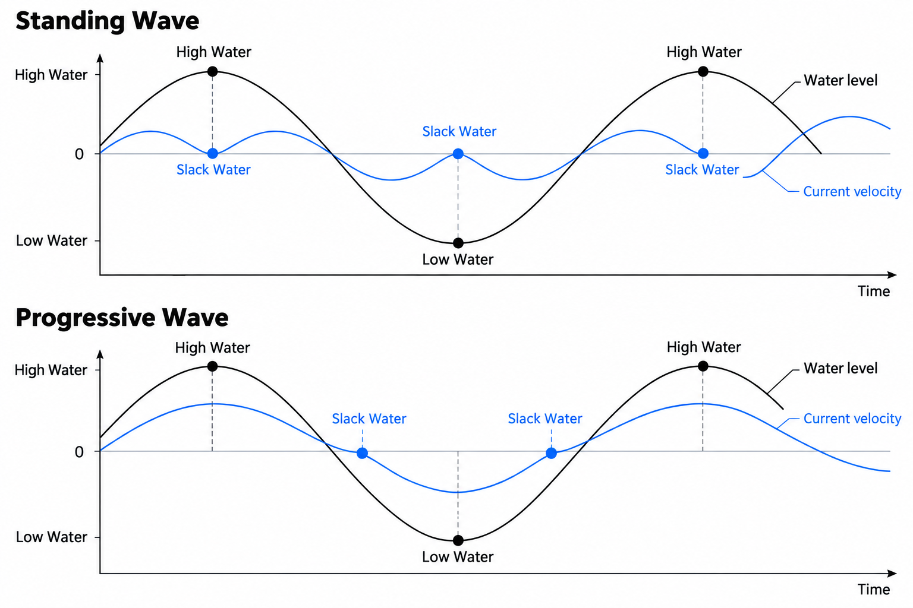
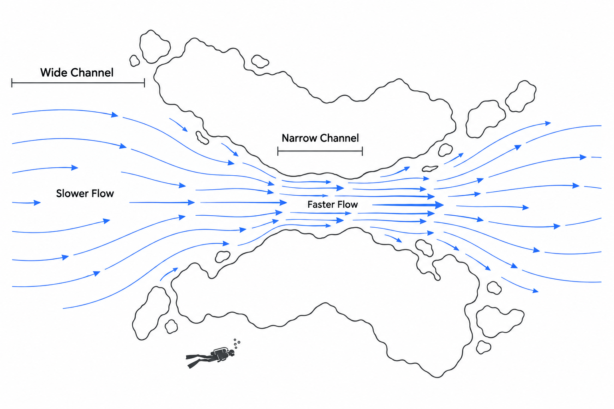

다이빙 포인트에 도착했을 때 수면이 거울처럼 잔잔하다고 해서, 물속까지 평온할 것이라고 생각해서는 안 됩니다. 수면에서는 거의 느껴지지 않던 물의 움직임이 수심 15미터의 암초 주변에서는 강한 조류로 나타나기도 합니다. 아무리 핀킥을 해도 앞으로 나아가기 어렵고, 조금 전까지 선명하게 보이던 산호 군락이 떠다니는 부유물에 가려지기도 합니다. 불과 한두 시간 차이로 같은 포인트가 전혀 다른 다이빙 환경으로 바뀌는 것입니다.

많은 다이버가 이런 차이를 단순히 운이 좋거나 나쁜 문제로 받아들입니다. 하지만 바닷물의 움직임 중 상당 부분은 지구와 달, 태양의 중력에 의해 주기적으로 발생하는 조석(Tide) 현상과 연결되어 있습니다. 만조(High Tide)와 간조(Low Tide)의 시간, 그리고 그 사이에 발생하는 조류(Tidal Current)의 변화를 이해하면 입수 시각을 훨씬 전략적으로 결정할 수 있습니다.

여기서 중요한 사실이 하나 있습니다. **물이 가장 높아지는 순간과 물의 흐름이 가장 약해지는 순간은 반드시 일치하지 않습니다.** 조석표를 제대로 읽는다는 것은 단순히 만조 시간을 확인하는 것이 아니라, 수위의 변화와 실제 조류의 움직임을 구분하고 다이빙에 유리한 시간대를 찾아내는 과정입니다.

### 만조와 간조: 바다가 움직이는 거대한 시계

바다의 수면은 하루 종일 같은 높이를 유지하지 않습니다. 달과 태양의 인력, 지구의 자전, 그리고 해역의 지형적 특성에 의해 주기적으로 상승하고 하강합니다. 수면이 가장 높아지는 시점을 만조(High Water), 가장 낮아지는 시점을 간조(Low Water)라고 부릅니다.

전형적인 반일주조(Semidiurnal Tide) 해역에서는 약 12시간 25분을 주기로 만조가 반복됩니다. 따라서 만조에서 다음 간조까지는 평균적으로 약 6시간 12분이 걸립니다. 하지만 모든 바다가 이러한 규칙을 따르는 것은 아닙니다. 하루에 만조와 간조가 한 번씩 나타나는 일주조(Diurnal Tide) 해역도 있고, 하루 두 번의 만조와 간조 높이가 서로 다른 혼합조(Mixed Tide) 해역도 존재합니다.

조석표에서 확인해야 할 정보는 단순한 시각뿐만이 아닙니다. 만조와 간조의 수위 차이인 조차(Tidal Range)도 중요합니다.

예를 들어 특정 해역의 간조 수위가 0.5미터, 만조 수위가 2.5미터라면 조차는 2미터입니다. 이는 한 번의 밀물 과정에서 수면 높이가 2미터 상승한다는 의미입니다. 일반적으로 다른 조건이 비슷할 때 조차가 커지면 더 많은 바닷물이 해안과 수로를 드나들고, 일부 구간에서는 조류도 강해질 가능성이 높아집니다.

달과 태양의 인력이 조석을 강화하는 사리(Spring Tide)에는 조차가 커지는 경향이 있고, 두 천체의 조석 효과가 부분적으로 상쇄되는 조금(Neap Tide)에는 조차가 작아지는 경향이 있습니다. 따라서 같은 다이빙 포인트라도 날짜에 따라 조류 환경이 크게 달라질 수 있습니다.

다만 조차만으로 조류의 속도를 정확하게 계산할 수는 없습니다. 실제 물의 흐름은 해저 지형과 수로의 형태, 주변 해역과의 수위 차이에 의해서도 결정되기 때문입니다.

### 물높이와 물의 속도: 정조는 왜 만조와 다를까

조석을 이해할 때 가장 흔히 발생하는 오해는 만조나 간조를 곧바로 정조(Slack Water)와 동일하게 생각하는 것입니다.

조석은 바닷물의 수직적인 높이 변화를 의미하지만, 조류는 바닷물의 수평적인 이동을 의미합니다. 밀물 때 해안이나 만 안쪽으로 유입되는 흐름을 창조류(Flood Current), 썰물 때 바깥으로 빠져나가는 흐름을 낙조류(Ebb Current)라고 합니다.

정조는 이러한 조류의 속도가 거의 0에 가까워지는 시기입니다. 왕복성 조류에서는 한 방향으로 흐르던 바닷물이 속도를 잃고 반대 방향으로 전환하는 순간에 발생합니다. 바로 이 전환 구간이 조류에 민감한 다이빙에서 중요한 입수 기회가 됩니다.

그렇다면 정조는 언제 찾아올까요?

일부 해역에서는 만조와 간조가 발생하는 시각에 조류도 거의 멈춥니다. 이러한 현상은 정재파(Standing Wave)에 가까운 조석 특성을 보이는 환경에서 나타납니다. 반면 진행파(Progressive Wave)의 특성이 강한 해역에서는 만조와 간조 부근에서 오히려 조류가 강하고, 그 중간 시점에 정조가 나타날 수 있습니다.

현실의 바다는 이처럼 단순한 두 가지 형태로만 움직이지 않습니다. 해안선의 굴곡, 만의 깊이, 수로의 폭, 물의 관성 및 마찰이 복합적으로 작용하기 때문에 같은 지역에서도 포인트별로 정조 시각이 달라집니다.

따라서 **조석표(Tide Table)와 조류 예측표(Tidal Current Table)는 서로 다른 정보를 제공한다는 사실**을 알아야 합니다. 조석표가 만조와 간조의 시각 및 수위를 알려준다면, 조류 예측표는 창조류와 낙조류의 최대 속도, 방향, 그리고 정조가 예상되는 시점을 보여줍니다.

만조가 오후 1시라고 해서 무조건 오후 1시에 입수하는 것은 정밀한 다이빙 계획이 아닙니다. 해당 포인트의 정조가 실제로 언제 발생하는지를 확인해야 합니다.

### 좁은 수로가 조류를 증폭시키는 물리학

왜 같은 시간에 다이빙하더라도 넓은 리프에서는 조류가 거의 느껴지지 않는데, 불과 수십 미터 떨어진 암초 사이에서는 몸이 떠밀릴 정도의 흐름이 발생할까요?

그 원인 중 하나는 유체의 연속성(Continuity)입니다.

일정한 양의 물이 흐르는 통로의 단면적이 좁아지면, 그 물을 통과시키기 위해 유속이 증가해야 합니다. 이를 단순화하면 다음과 같이 표현할 수 있습니다.

$$
Q = A × v
$$

여기서 Q는 단위 시간당 통과하는 물의 부피인 유량(Flow Rate), A는 흐름에 수직인 통로의 단면적, v는 평균 유속(Current Velocity)을 의미합니다. 같은 유량이 유지된다면 통로의 단면적이 절반으로 감소할 때 평균 유속은 두 배로 증가합니다.

이 원리는 두 섬 사이의 좁은 해협, 리프 사이의 채널, 수중 절벽이 만드는 병목 구간에서 조류가 강해지는 현상을 설명하는 데 유용합니다. 물론 실제 바다에서는 압력 차이와 마찰, 주변으로 우회하는 흐름 때문에 모든 구간의 유속이 이 비율대로 증가하지는 않습니다.

중요한 것은 조석표가 보여주는 수위 변화가 다이빙 포인트 전체의 조류 강도를 균일하게 설명하지 못한다는 점입니다. 암초 뒤쪽의 물은 상대적으로 잔잔할 수 있지만, 암초 끝을 돌아 나가는 순간 강한 흐름을 만날 수 있습니다. 수면의 조류와 바닥 부근의 조류도 서로 다를 수 있습니다.

여기에 바람에 의한 표층 해류, 파랑, 지역적인 잔류류(Residual Current)가 더해지면 상황은 더욱 복잡해집니다. 조석으로 발생한 조류가 잠시 약해지더라도 다른 원인으로 움직이는 물까지 반드시 멈추는 것은 아닙니다.

결국 정조 시간을 읽는 능력만큼 중요한 것은 그 시간이 실제 다이빙 지형에 어떤 형태로 나타나는지를 이해하는 능력입니다.

### 정조가 시야를 좋게 만드는 진짜 조건

조류가 약해지면 수중 시야(Underwater Visibility)도 무조건 좋아질까요? 반드시 그렇지는 않습니다.

시야를 결정하는 것은 물의 이동 속도 자체보다 물속에 떠 있는 입자의 양입니다. 해저의 고운 모래와 실트(Silt), 강에서 유입된 퇴적물, 플랑크톤 등은 빛을 산란시키고 수중 시야를 감소시킵니다. 조류가 강해져 바닥에 가라앉아 있던 미세 입자가 다시 떠오르는 현상을 재부유(Resuspension)라고 합니다.

조류가 약해지면 바닥을 휘젓는 힘이 감소하므로 추가적인 재부유가 줄어들 수 있습니다. 하지만 이미 떠 있는 입자가 즉시 바닥으로 가라앉는 것은 아닙니다. 특히 미세한 입자는 상당한 시간 동안 물속에 남아 있을 수 있습니다.

시야를 좌우하는 또 하나의 변수는 어느 방향에서 물이 들어오는가입니다.

강 하구나 연안의 일부 포인트에서는 육지에서 유입된 탁한 물이 썰물에 바다로 빠져나가면서 시야가 나빠지고, 밀물에는 상대적으로 맑은 외해의 물이 유입되면서 시야가 좋아질 수 있습니다. 이런 환경에서는 만조 부근의 정조가 조류와 시야를 동시에 만족시키는 유리한 시간이 됩니다.

반대로 외해에서 유입되는 물 자체에 부유물이 많거나, 특정 조류 방향에서 해저 퇴적물이 더 많이 움직이는 포인트라면 다른 결과가 나타날 수 있습니다. 큰 파도가 계속해서 바닥을 흔들고 있다면 정조 시간에도 시야는 개선되지 않을 수 있습니다.

따라서 최고의 수중 시야는 단순히 조류가 멈추었다는 사실만으로 결정되지 않습니다. **약한 조류, 맑은 수괴(Water Mass)의 유입, 낮은 퇴적물 재부유가 동시에 충족되는 시간**이 해당 포인트의 좋은 다이빙 타임이 됩니다.

### 조석표를 실제 입수 시각으로 바꾸는 기술

이제 조석표를 단순한 해양 정보가 아니라 실제 다이빙 스케줄을 설계하는 도구로 활용해 봅시다.

가장 먼저 확인할 것은 다이빙 날짜와 포인트에 가까운 관측 지점의 만조·간조 시각, 예상 수위 및 조차입니다. 조석 예측 시각의 시간대(Time Zone)가 현지 시각과 일치하는지도 확인해야 합니다.

다음으로 해당 포인트 또는 가장 적절한 인근 지점의 조류 예측을 확인합니다. 창조류와 낙조류의 최대 속도, 정조 시각, 정조 전후의 유속 변화가 핵심입니다. 조류 예측 자료가 없는 포인트라면 단순히 가장 가까운 항구의 만조 시간만으로 정조를 확정해서는 안 됩니다. 경험 있는 현지 다이브 운영자나 가이드의 실제 관측 기록이 중요해집니다.

가령 어느 다이빙 포인트의 간조가 오전 6시 30분이고 만조가 오후 12시 40분이라고 가정해 봅시다. 그런데 해당 포인트의 조류 예측에서는 오전 11시 55분에 정조가 나타나는 것으로 확인되었습니다.

이 경우 다이빙의 핵심 시간은 오후 12시 40분이라는 만조 시각이 아니라 오전 11시 55분 전후의 약류 구간입니다. 수면 이동과 하강에 걸리는 시간을 역산해 입수를 계획하고, 조류가 다시 강해지기 전에 주요 관찰 구간을 통과하거나 안전한 출수 지점으로 복귀할 수 있도록 동선을 설계해야 합니다.

여기서 정조를 중심으로 무조건 앞뒤 30분이나 1시간을 사용할 수 있다고 가정해서는 안 됩니다. 정조가 얼마나 오래 지속되는지는 포인트와 날짜에 따라 달라집니다. 특히 조류 변화가 빠른 좁은 수로에서는 예측 시각의 오차나 출수 지연이 곧바로 어려운 상황으로 이어질 수 있습니다.

입수 전에는 풍향과 풍속, 파고, 최근 강우량, 실제 수면 및 수중 조류 상태까지 확인해야 합니다. 조류가 예상보다 강하거나 계획한 출수 경로가 유지되지 않는다면 다이빙을 연기하거나 포인트를 변경하는 것이 합리적입니다. 드리프트 다이빙(Drift Diving)처럼 조류를 의도적으로 이용하는 방식은 별도의 회수 계획과 훈련이 전제되는 다른 종류의 계획입니다.

좋은 다이빙 타임은 단순히 가장 일찍 출항할 수 있는 시간도, 햇빛이 가장 강한 정오도 아닙니다. 바다의 움직임을 이해하고 그날의 환경에서 가장 유리한 조건을 선택한 결과입니다.

조석표는 바닷물의 높이를 예측하지만, **다이버가 정말 알아야 할 것은 자신이 들어갈 장소에서 물이 언제, 어느 방향으로, 얼마나 빠르게 움직일 것인가**입니다. 그 차이를 이해하는 순간 다이빙은 조류에 맞서 버티는 활동에서 바다의 리듬을 이용하는 기술로 바뀝니다.
