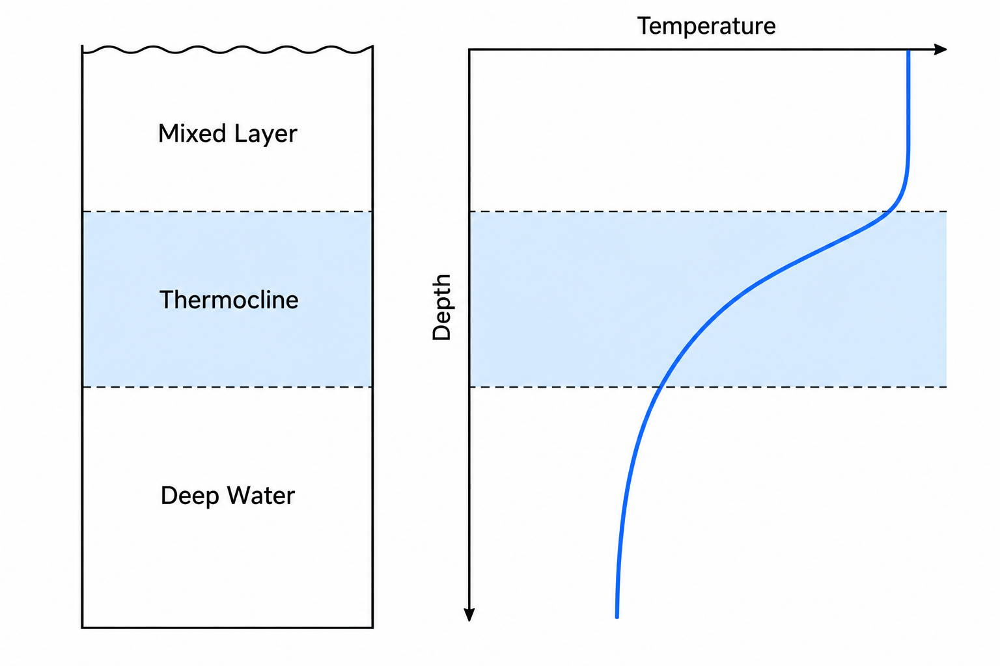
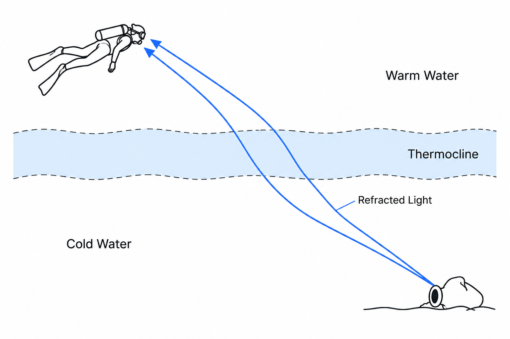

수심 15미터를 지나 천천히 하강하던 중, 눈앞의 바닷물이 갑자기 일렁이는 경험을 한 적이 있을 것입니다. 마치 뜨거운 아스팔트 위로 피어오르는 아지랑이처럼 수중 풍경이 흐릿하게 흔들립니다. 몇 번의 핀킥으로 그 경계를 통과하는 순간, 슈트 안쪽으로 차가운 물이 스며들고 방금까지 따뜻했던 바다는 전혀 다른 공간으로 변합니다.

많은 다이버는 이를 단순히 수심이 깊어져 수온이 내려가는 현상으로 이해합니다. 하지만 바닷물의 온도는 수심에 비례해 일정하게 떨어지지 않습니다. 수 미터를 이동하는 동안 수온이 거의 변하지 않다가, 특정 구간에서 급격히 낮아질 수 있습니다. 마치 보이지 않는 유리벽을 사이에 두고 따뜻한 물과 차가운 물이 서로 다른 층을 이루고 있는 것처럼 말입니다.

이 경계가 바로 **서모클라인(Thermocline), 즉 수온약층**입니다. 단순한 온도 변화처럼 보이지만, 그 이면에는 바닷물의 밀도와 혼합을 지배하는 물리 법칙이 숨어 있습니다. 이 원리를 이해하면 다이빙 도중 갑작스럽게 찾아오는 한기뿐 아니라, 때로는 함께 나타나는 시야 변화까지 더욱 정확하게 해석할 수 있습니다.

### 바닷물은 왜 하나로 섞이지 않는가

바다는 거대한 물덩어리처럼 보이지만, 내부의 물이 언제나 균일하게 섞여 있는 것은 아닙니다. 태양에 의해 가열된 표층의 바닷물은 상대적으로 따뜻하고, 충분한 열을 공급받지 못하는 깊은 곳의 바닷물은 일반적으로 더 차갑습니다.

여기서 중요한 물리량은 **밀도**입니다. 염분과 압력 조건이 비슷하다면 따뜻한 바닷물은 상대적으로 밀도가 낮고, 차가운 바닷물은 밀도가 높습니다. 따라서 가벼운 물이 위에, 무거운 물이 아래에 놓이는 안정적인 층상 구조가 만들어질 수 있습니다.

이는 투명한 컵에 차가운 물을 담고 그 위로 따뜻한 물을 조심스럽게 부었을 때 두 물층이 쉽게 뒤섞이지 않는 현상과 비슷합니다. 물론 실제 바다에서는 파도와 바람, 조류가 지속적으로 물을 섞지만, 수직 방향으로 밀도가 증가하는 구조는 이러한 혼합에 저항합니다.

표층에는 바람과 파도에 의해 수온이 비교적 균일해진 혼합층(Mixed Layer)이 형성될 수 있습니다. 그 아래에서 수온이 짧은 수직 거리 동안 빠르게 변하는 구간이 수온약층입니다. 이 경계는 단단한 막이 아니라, 서로 다른 수괴(Water Mass)가 만나는 연속적인 전이 구간입니다.

여기서 한 가지 구분할 개념이 있습니다. 수온이 급격하게 변하는 층을 수온약층(Thermocline), 염분이 급격하게 변하는 층을 염분약층(Halocline), 밀도가 급격하게 변하는 층을 밀도약층(Pycnocline)이라고 합니다. 바닷물의 밀도는 수온뿐 아니라 염분과 압력에도 영향을 받으므로, 이 세 가지 경계가 언제나 정확히 일치하는 것은 아닙니다.

### 몇 미터 차이가 만드는 갑작스러운 한기

서모클라인이 다이버에게 인상적으로 느껴지는 이유는 온도의 변화가 짧은 수직 거리 안에 집중될 수 있기 때문입니다.

예를 들어 수심 16미터에서 28°C를 유지하던 바닷물이 19미터에서 24°C까지 떨어지는 상황을 가정해 봅시다. 불과 3미터를 더 내려갔을 뿐이지만, 다이버는 4°C의 수온 차이를 경험하게 됩니다. 물론 이는 설명을 위한 가상의 예시이며, 실제 온도 차이와 수온약층의 깊이는 지역과 계절에 따라 달라집니다.

문제는 이러한 온도 변화가 우리 몸의 열 손실에 직접적인 영향을 준다는 점입니다. 물은 공기보다 열전달 능력이 훨씬 크기 때문에, 다이버의 신체와 주변 바닷물 사이에 온도 차이가 생기면 지속적으로 열이 이동합니다. 웻슈트 내부로 새로운 찬물이 유입되거나 움직임에 따라 내부의 물이 교환된다면 한기는 더욱 뚜렷해질 수 있습니다.

특히 따뜻한 표층 수온만을 기준으로 슈트 두께를 선택했다면, 예상하지 못한 수온약층 아래에서 불필요한 열 손실을 겪을 수 있습니다. 장시간의 냉수 노출은 손가락의 민첩성과 집중력을 떨어뜨리고, 심해지면 떨림과 체온 저하로 이어질 수 있습니다.

중요한 것은 서모클라인 자체가 차가운 물을 만들어내는 현상이 아니라는 사실입니다. **이미 존재하는 서로 다른 온도의 물층 사이에서, 수온 변화가 짧은 구간에 집중되어 나타나는 것**입니다.

### 물속에 아지랑이가 피어오르는 이유

서모클라인을 통과할 때 주변의 암초나 버디가 갑자기 흐릿하게 보이는 경우가 있습니다. 마치 투명한 유리 너머로 수중 풍경을 바라보는 것처럼 물체의 윤곽이 흔들리거나 일그러지는 현상입니다.

그 원인 중 하나는 빛의 굴절(Refraction)입니다.

빛은 매질의 굴절률(Refractive Index)에 따라 진행 방향이 달라집니다. 바닷물의 굴절률은 온도와 염분 등의 영향을 받는데, 서로 다른 수온의 물이 만나는 경계에서 작은 규모의 혼합과 난류가 발생하면 굴절률도 공간적으로 불균일해질 수 있습니다.

이러한 구간을 통과하는 빛은 진행 경로가 조금씩 변합니다. 우리가 보는 수중 물체의 위치와 윤곽이 순간적으로 흔들리는 이유입니다. 뜨거운 도로 위에서 먼 풍경이 일렁이는 아지랑이와 유사한 광학적 현상이라고 볼 수 있습니다.

하지만 여기서 **상이 일그러지는 현상과 실제 시야 거리가 짧아지는 현상은 구분해야 합니다.**

굴절률의 불균일은 물체의 상을 흔들리거나 흐릿하게 만들 수 있지만, 수중 시야를 결정하는 또 다른 중요한 요소는 빛의 산란(Scattering)과 흡수(Absorption)입니다. 물속에 부유하는 미세 입자나 플랑크톤이 많아지면 빛이 여러 방향으로 산란되어 실제 가시거리가 짧아질 수 있습니다.

수온과 밀도에 의한 성층 구조는 물의 수직 혼합과 영양염 공급에 영향을 주기 때문에, 특정 깊이에 플랑크톤이나 입자가 집중되는 환경과 연관될 수 있습니다. 그 결과 수온약층 부근에서 시야가 나빠지기도 합니다.

그러나 모든 서모클라인 아래가 탁한 것은 아닙니다. 경계를 통과한 뒤 오히려 더 맑은 물을 만나는 경우도 있습니다. 서모클라인은 수온의 급격한 변화로 정의되는 층이지, 반드시 시야를 차단하는 탁수층을 의미하지는 않기 때문입니다.

### 보이지 않는 경계를 예측하는 환경적 징후

서모클라인은 언제나 뚜렷하게 보이는 것은 아니지만, 주변 환경을 관찰하면 그 존재를 추정할 수 있는 단서들이 있습니다.

첫 번째는 계절과 표층의 가열 상태입니다. 햇빛이 강하고 표층이 따뜻해진 시기에는 표층과 깊은 물 사이의 온도 차이가 커지면서 비교적 강한 수온 성층이 발달할 수 있습니다. 반대로 강한 바람과 파도, 표층 냉각에 의한 혼합이 활발해지면 얕은 수온약층이 약해지거나 더 깊어질 수 있습니다.

두 번째는 수중에서 관찰되는 광학적 변화입니다. 하강 도중 특정 수심에서 가느다란 아지랑이처럼 물결치는 구간이 보이거나, 부유물의 분포가 수평 방향으로 달라지는 현상을 발견한다면 물의 성질이 변하는 경계일 가능성을 생각해 볼 수 있습니다. 다만 이러한 현상만으로 수온약층의 존재를 확정할 수는 없습니다.

세 번째는 실제 수온 정보입니다. 같은 다이빙 포인트에서 이전 다이빙의 수온 기록을 확인하거나, 현지 가이드에게 특정 깊이의 수온을 물어보는 것이 훨씬 직접적인 방법입니다. 하강하면서 다이브 컴퓨터의 수온 변화를 관찰하는 것도 도움이 되지만, 온도 센서는 실제 주변 수온 변화에 약간 늦게 반응할 수 있습니다.

또한 서모클라인의 깊이가 항상 수평으로 일정하다고 가정해서는 안 됩니다. 바닷속에서는 내부파(Internal Wave)와 조류, 수괴의 이동에 의해 수온약층의 깊이가 시간과 장소에 따라 달라질 수 있습니다. 같은 다이빙 포인트라도 오전과 오후에 서로 다른 깊이에서 차가운 물을 만날 수 있는 이유입니다.

결국 가장 신뢰할 수 있는 예측은 하나의 시각적 징후가 아니라, **사전 수온 정보와 실제 수중 관찰을 함께 해석하는 것**입니다.

### 수온약층을 읽는 다이버의 판단

서모클라인은 피해야만 하는 위험 요소가 아닙니다. 오히려 바다의 내부 구조를 이해할 수 있게 해주는 중요한 환경적 단서입니다. 다만 그 경계를 통과하면서 발생하는 수온과 시야 변화는 다이빙 계획에 영향을 줄 수 있습니다.

다이빙 전에는 수면 온도보다 계획된 최대 수심 부근의 예상 최저 수온을 기준으로 보온 장비를 검토해야 합니다. 하강 도중 예상보다 큰 온도 차이를 느낀다면 잠시 안정적인 부력을 유지하며 자신의 상태와 버디의 반응을 확인하는 것이 좋습니다. 시야가 줄어들었다면 버디와의 거리를 조정하고, 방향과 수심을 확인하는 데 더 많은 주의를 기울여야 합니다.

추위로 인해 손의 움직임이 둔해지거나 지속적인 떨림이 발생한다면 계획된 최대 수심이나 체류 시간을 고집할 이유가 없습니다. 버디와 의사소통하여 다이빙을 조기에 종료하는 판단이 필요할 수 있습니다. 단, 따뜻한 수층으로 이동하기 위해 상승할 때도 계획된 상승 속도와 감압·안전 정지 절차를 준수해야 합니다.

바다는 수면에서 바닥까지 하나의 균일한 환경이 아닙니다. 우리가 보지 못하는 곳에서도 온도와 염분, 밀도는 끊임없이 변하며 서로 다른 물의 층을 만들어냅니다.

서모클라인을 이해한다는 것은 단순히 차가운 물이 나타나는 수심을 기억하는 일이 아닙니다. 지금 내가 통과하고 있는 물의 성질이 왜 달라지는지, 그리고 그 변화가 내 신체와 시야에 어떤 영향을 주는지 읽어내는 능력을 기르는 것입니다.

**좋은 다이버는 수심계의 숫자만 읽지 않습니다. 눈에 보이지 않는 바다의 경계까지 읽어냅니다.**
