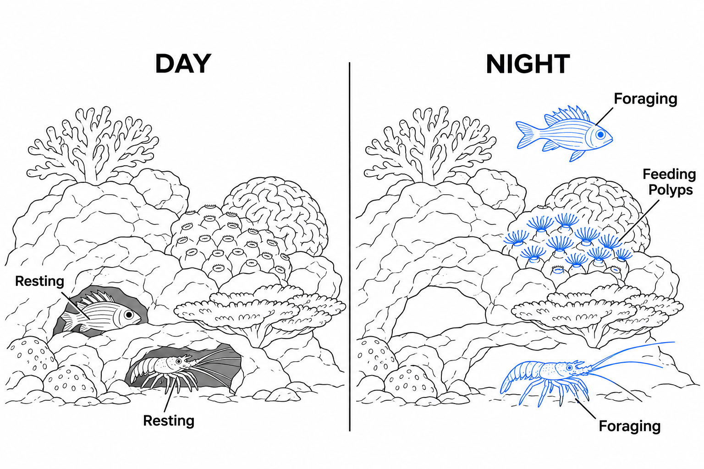
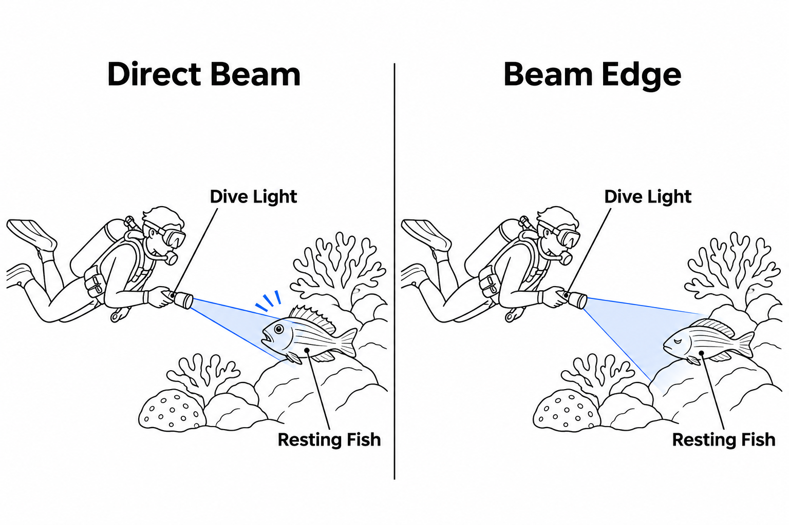
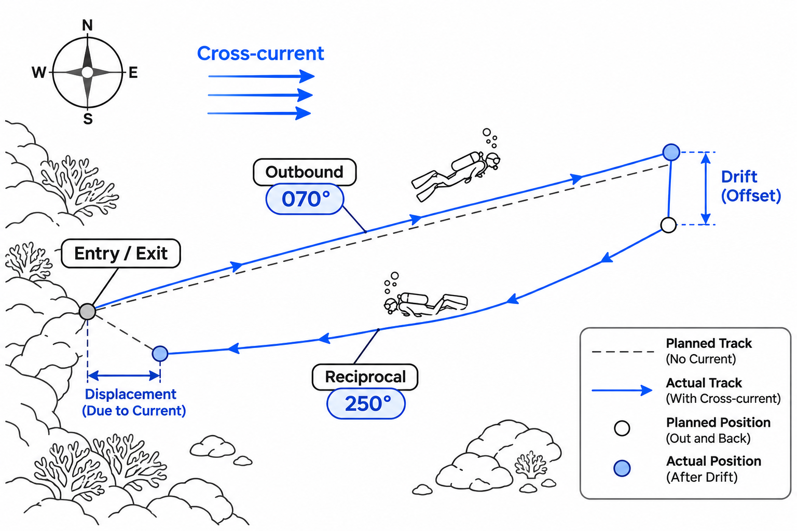

해가 완전히 저문 뒤 바다에 들어가면, 낮에는 익숙했던 산호초가 전혀 다른 공간으로 느껴집니다. 수면 아래로 하강하는 순간 사방으로 펼쳐지던 푸른 풍경은 사라지고, 오직 다이브 라이트가 비추는 작은 원 안에서만 세상이 모습을 드러냅니다. 시야는 좁아지고, 호흡기에서 빠져나가는 기포 소리는 유난히 선명하게 느껴집니다. 불과 몇 시간 전까지 헤엄치던 바로 그 바다인데도, 마치 처음 방문한 장소처럼 낯설게 다가옵니다.

많은 다이버가 야간 다이빙을 단순히 낮에 하던 다이빙을 어두운 환경에서 반복하는 활동으로 생각합니다. 하지만 밤의 바다는 단순히 조명이 꺼진 낮의 바다가 아닙니다. 낮 동안 바위틈에 숨어 있던 생물들이 사냥을 시작하고, 활발하게 움직이던 물고기들은 은신처를 찾아 휴식에 들어갑니다. 산호초라는 하나의 공간에서 낮과 밤을 살아가는 서로 다른 생태계가 교대하는 것입니다.

흥미로운 변화는 다이버 자신에게도 일어납니다. 넓은 풍경을 한눈에 읽던 시각 정보가 줄어들면서 우리는 평소 무심히 지나쳤던 소리와 물의 움직임에 더 많은 주의를 기울이게 됩니다. 야간 다이빙의 진정한 매력은 어둠 속에서 무언가를 찾아내는 것뿐 아니라, 익숙한 바다를 전혀 다른 방식으로 경험하는 데 있습니다.

### 해가 지면 시작되는 바다의 두 번째 하루

낮 동안 산호초를 관찰하다 보면 수많은 물고기가 바쁘게 움직이는 모습을 볼 수 있습니다. 그러나 그 화려한 풍경이 바다 생태계의 전부는 아닙니다. 해가 지고 주변의 빛이 줄어들면 생물들의 활동 시간대가 바뀌기 시작합니다. 이러한 주야간 활동 패턴(Diel Activity Pattern)은 생물마다 다른 먹이 활동, 포식 위험, 생체 리듬에 의해 형성됩니다.

대표적인 야행성 어류인 스쿼럴피시(Squirrelfish)는 낮에는 바위틈이나 산호 아래에 숨어 있다가 밤이 되면 먹이를 찾아 밖으로 나옵니다. 가시바닷가재(Spiny Lobster) 역시 낮 동안 은신처에 머물다가 밤에 해저를 돌아다니며 먹이를 찾는 경우가 많습니다. 일부 문어와 곰치도 밤에 활발한 사냥 행동을 보입니다.

더 놀라운 변화는 움직일 수 없는 산호에서 발견됩니다. 단단한 석회질 골격으로 보이는 산호 역시 수많은 작은 동물인 폴립(Polyp)으로 구성되어 있습니다. 많은 산호는 밤이 되면 촉수를 펼쳐 주변을 떠다니는 동물성 플랑크톤을 포획합니다. 촉수에 있는 자포(Nematocyst)는 먹이가 접촉했을 때 독성 구조물을 발사해 포획을 돕습니다.

낮에는 정적인 바위처럼 보이던 산호 표면이 밤에는 수많은 촉수로 뒤덮인 먹이 사냥터로 변하는 것입니다. 같은 산호초라도 언제 방문하느냐에 따라 전혀 다른 생명의 모습을 관찰할 수 있는 이유입니다.

### 시야가 사라질수록 선명해지는 감각

야간 다이빙에서 가장 먼저 달라지는 것은 시야의 범위입니다. 낮에는 수십 미터 앞까지 이어지는 지형을 한 번에 파악할 수 있지만, 밤에는 라이트의 빛이 닿는 영역만 명확하게 보입니다. 이때 다이버는 넓은 공간을 지속적으로 확인하는 대신, 제한된 영역에 집중하게 됩니다.

인간의 망막에는 밝은 환경에서 색과 세부 형태를 구별하는 원추세포(Cone Cell)와 약한 빛에 민감한 간상세포(Rod Cell)가 있습니다. 어두운 환경에 머물면 간상세포 중심의 시각 기능이 점차 적응하며, 이를 암순응(Dark Adaptation)이라고 합니다. 그러나 강한 라이트를 정면으로 바라보면 적응된 야간 시력이 일시적으로 저하될 수 있습니다.

시각 정보가 줄어들면 다른 감각에도 변화가 생긴 것처럼 느껴집니다. 호흡기에서 배출되는 기포 소리, 몸을 스치는 미세한 수류, 핀을 움직일 때 느껴지는 저항이 평소보다 뚜렷하게 의식됩니다. 실제로 청각이나 촉각 기관 자체의 민감도가 갑자기 높아진다기보다는, 시각에 집중하던 주의가 다른 감각 정보로 분산되는 경험에 가깝습니다.

그렇다고 이러한 감각만으로 방향을 정확하게 판단할 수 있는 것은 아닙니다. 특히 물속에서는 소리가 공기 중보다 훨씬 빠르게 전달되므로, 인간은 소리가 발생한 방향을 정확하게 구분하기 어렵습니다. 눈에 보이는 기준점이 줄어들면 자신의 이동 방향이나 수심 변화를 잘못 인식할 가능성도 높아집니다.

야간 다이빙에서 감각의 변화는 새로운 즐거움인 동시에 경계해야 할 특성입니다. 주변의 움직임을 더 세밀하게 느끼되, 실제 수심과 방향은 다이브 컴퓨터와 컴퍼스라는 객관적인 계기에 의존해야 합니다.

### 라이트 에티켓: 빛은 관찰 도구이자 간섭이다

야간 다이빙에서 라이트는 단순히 어둠을 밝히는 손전등이 아닙니다. 다이버의 시야를 확보하고, 버디와 의사소통하며, 자신의 위치를 알리는 중요한 안전 장비입니다. 하지만 이 빛은 동시에 해양 생물의 자연스러운 행동을 방해할 수도 있습니다.

강한 빛을 야행성 생물에게 직접 비추면 일부 개체는 움직임을 멈추거나 은신처로 도망갈 수 있습니다. 휴식 중인 물고기가 갑작스럽게 빛을 받으면 놀라 주변의 산호나 바위에 충돌할 가능성도 있습니다. 생물의 행동을 관찰하기 위해 비춘 빛이 오히려 관찰하려던 행동 자체를 바꾸어 놓는 역설적인 상황입니다.

그래서 좋은 라이트 에티켓의 핵심은 밝기가 아니라 빛을 다루는 방식에 있습니다. 생물을 발견했다면 가장 강한 중앙 광선 대신 상대적으로 약한 빔의 가장자리로 비추고, 관찰에 필요한 만큼만 밝기를 사용합니다. 특히 휴식 중인 물고기나 빛에 회피 반응을 보이는 생물을 지속적으로 쫓아가며 비추지 않아야 합니다.

버디에게 라이트를 사용하는 방식 역시 중요합니다. 상대방의 얼굴이나 마스크에 직접 빛을 비추면 야간 시력을 일시적으로 떨어뜨리고 주변 상황을 파악하기 어렵게 만들 수 있습니다. 가까운 거리에서는 자신의 손에 빛을 비춰 기존 수신호를 전달하고, 멀리서는 사전에 합의한 라이트 신호(Light Signal)를 사용합니다.

작은 원을 그리는 신호는 일반적으로 OK를 의미하며, 좌우로 빛을 흔드는 동작은 주의를 끌기 위해 사용됩니다. 다만 신호의 정확한 의미와 사용법은 입수 전 버디와 반드시 일치시켜야 합니다.

밝은 라이트가 언제나 더 좋은 시야를 제공하는 것도 아닙니다. 물속에 부유물이 많으면 강한 광선이 입자에 의해 산란되어 다이버의 눈으로 되돌아오는 후방산란(Backscatter)이 발생합니다. 자동차 헤드라이트가 짙은 안개를 비출 때 오히려 앞이 뿌옇게 보이는 것과 비슷한 현상입니다. 이럴 때는 무조건 밝기를 높이기보다 출력과 조사 방향을 조절하는 편이 더 효과적일 수 있습니다.

### 어둠 속에서 길을 잃지 않는 방법

낮에는 커다란 산호 군락이나 바위의 형태, 수면에서 내려오는 빛을 이용해 대략적인 위치를 판단할 수 있습니다. 하지만 밤에는 이러한 자연적인 기준점(Natural Reference)이 훨씬 제한적으로 보입니다. 라이트를 다른 방향으로 돌리는 것만으로도 방금 지나온 지형을 알아보지 못할 수 있습니다.

이 때문에 야간 다이빙의 방향 유지에서 가장 중요한 도구는 수중 컴퍼스(Underwater Compass)입니다. 입수 전 진입 방향을 확인하고, 이동 중에는 주기적으로 방위각(Bearing)을 점검해야 합니다.

예를 들어 출발 지점에서 70도 방향으로 직선 이동했다면, 단순한 왕복 경로의 귀환 방위각은 여기에 180도를 더한 250도가 됩니다. 이것을 역방위각(Reciprocal Bearing)이라고 합니다.

그러나 컴퍼스가 알려주는 것은 어디를 향하고 있는가이지, 실제로 얼마나 이동했는가가 아닙니다. 조류가 옆으로 흐르면 다이버는 정해진 방향을 바라보면서도 실제 이동 경로에서는 옆으로 밀릴 수 있습니다. 따라서 방향뿐 아니라 이동 시간, 핀킥 횟수, 수심 변화, 해저 지형을 함께 확인해야 합니다.

가장 좋은 방법은 낮에 이미 다이빙했던 익숙한 포인트에서 야간 다이빙을 시작하는 것입니다. 모래 바닥이 암반으로 바뀌는 경계, 큰 바위의 위치, 리프의 경사 방향 등을 미리 기억해 두면 컴퍼스의 방위 정보와 자연 지형을 교차 확인할 수 있습니다.

보트나 해안의 출수 지점에는 사전에 합의된 위치 표시 조명을 설치하고, 이동 경로와 최대 수심, 복귀 시점, 기체 여유량을 버디와 공유해야 합니다. 야간에는 평소보다 짧고 단순한 동선을 선택하는 편이 방향 오차와 분리 위험을 줄이는 데 유리합니다.

### 어둠 속에서 가장 중요한 안전 마진

야간 다이빙을 위한 준비에서 가장 기본적인 원칙은 광원을 하나에만 의존하지 않는 것입니다. 주 라이트와 독립적으로 작동하는 백업 라이트를 갖추고, 입수 전에 배터리와 작동 상태를 모두 점검해야 합니다.

만약 다이빙 도중 주 라이트가 고장 난다면 무작정 이동하거나 상승하지 말고, 먼저 움직임을 멈추고 백업 라이트로 시야를 확보해야 합니다. 이후 버디에게 상황을 알리고 계획된 절차에 따라 다이빙을 종료하는 것이 원칙입니다.

버디의 라이트가 보이지 않는 상황에서도 즉시 방향을 바꾸어 헤엄치는 것은 위험합니다. 자신의 라이트를 몸쪽으로 가려 주변의 다른 광원을 확인하고, 사전에 합의한 버디 분리 절차에 따라 제한적으로 탐색해야 합니다. 재합류하지 못하면 계획된 절차에 따라 수심과 상승 속도를 통제하며 안전하게 다이빙을 종료해야 합니다.

무엇보다 어둠 속에서는 부력 조절이 더욱 중요해집니다. 수심을 짐작할 만한 시각적 기준점이 부족하기 때문에 자신도 모르게 상승하거나 하강할 수 있습니다. 안정적인 중성 부력, 주기적인 수심 확인, 버디와의 가까운 거리 유지가 라이트의 밝기만큼 중요한 이유입니다.

야간 다이빙은 더 깊고 멀리 탐험하는 활동일 필요가 없습니다. 오히려 익숙한 포인트에서 이동 속도를 늦추고, 작은 범위에 집중할 때 평소 발견하지 못했던 생명과 행동을 관찰할 수 있습니다.

낮의 바다가 넓은 풍경을 감상하는 공간이라면, 밤의 바다는 작은 빛의 원 안에서 생명의 움직임을 발견하는 공간입니다. 어둠은 바다의 아름다움을 지워버리는 것이 아니라, 낮의 빛이 가리고 있던 또 다른 모습을 드러냅니다.

결국 훌륭한 야간 다이버는 어둠을 가장 밝게 비추는 사람이 아닙니다. **자신에게 필요한 빛은 충분히 확보하면서도, 바다와 그 안의 생명에게는 가능한 한 적게 간섭하는 사람입니다.**
